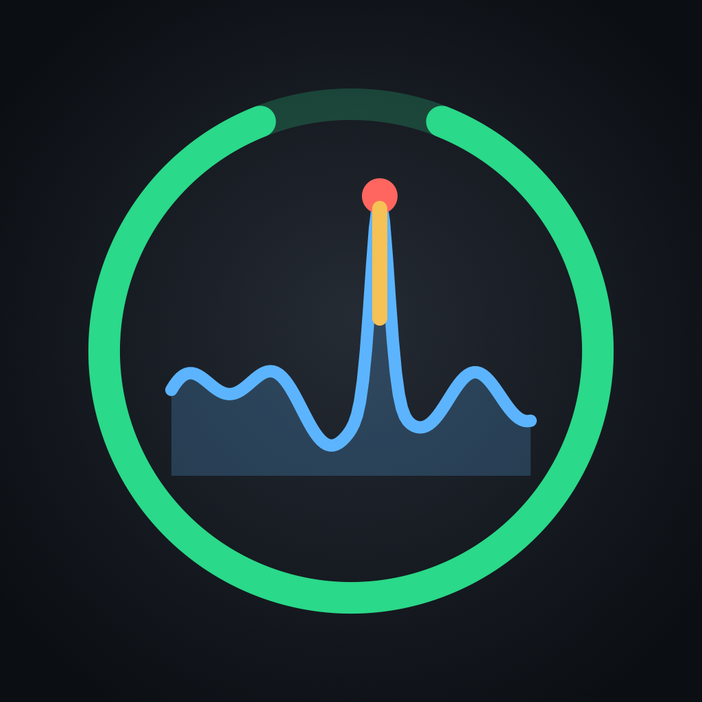

# RingOut

**Two-channel real-time feedback suppression for live vocal mics, on an iPad you already own.**

RingOut turns an M4-or-newer iPad plus a class-compliant USB audio interface into a feedback-suppression insert. It sits between a console insert send and return (or between a mic and the console) and adds no algorithmic latency.

- Landing page: https://juandozuna.github.io/RingOut/
- Status: **V1 in development.** The app, the engine and the setup flow run today, including a neural feedback isolator trained locally on open data (VCTK speech, VocalSet singing) and simulated PA loops. It runs on the audio thread with zero added latency. All results so far are from simulated loops, not a real room (see [Limitations](#limitations)).

## What's in the repo

| Path | What it is |
| --- | --- |
| `Sources/RingOutEngine/` | C++20 real-time engine behind a small C API (`include/ringout_engine.h`): DC block, 80 Hz HPF, 1024-pt FFT feedback detector with peak tracking and a logistic classifier, adaptive notch bank (8 auto + 4 fixed, Q≈60), neural isolator (causal gated TCN, 18k parameters, weights compiled in from `NeuralWeights.inc`) with a DSP fallback, equal-power Strength mix, −0.3 dBFS limiter, meters, spectrum, lock-free parameter/event queues. Also includes a simulated acoustic feedback loop (`ro_sim_*`) for demos and tests. |
| `Tests/RingOutEngineTests/` | 42 engine tests (`swift test`): bit-exact bypass, zero latency, unity gain, detection speed, false-positive resistance on vibrato vocals, notch lifecycle and merging, synthetic closed-loop stability, C++/PyTorch parity of the network, per-isolator gain margins for speech and singing, performance. |
| `ml/` | Training pipeline for the neural isolator (PyTorch): data packing, room generation, closed-loop training, evaluation, export to C++. See [`ml/README.md`](ml/README.md). |
| `research/` | Research notes with sources, e.g. what neural feedback suppression needs. |
| `App/` | The iPadOS app (SwiftUI, Swift 6, iPadOS 26+). XcodeGen spec in `App/project.yml`; generated project committed as `App/RingOut.xcodeproj`. |
| `App/RingOut/Audio/RenderGlue.c` | The only non-engine code on the Core Audio I/O thread: RemoteIO in → engine → out, written in C (no Swift, no allocation, no locks), plus Out 2 → In 2 loopback latency measurement. |
| `docs/` | GitHub Pages landing page. |
| `tools/make_icon.swift` | Renders the app icon. |

## The app

Landscape-only, dark, stage-safe. Every screen in the PRD is implemented:

| Screen | Highlights |
| --- | --- |
| S1 Welcome | Hue-style setup ring, "Start setup", import a show file from Files |
| S2 Setup wizard | Connect (live USB interface detection, wrong-route warning, power source) · Wiring (topologies A/B/C, 1 or 2 channels) · Checks (session, requested vs actual buffer, I/O buffer mismatch from accessibility features, reported latency, mains power, direct-monitor confirmation) · Calibrate (signal in the −18 dBFS band, loopback latency, 60 s / 10 min stress test with automatic step-up to the next buffer) · Done (summary, save show file) |
| S3 Live | Two full-height channel strips whose background colour is the channel state (safe / working / ring / bypass), input and output meters with −18/−6 marks, peak hold and clip latch, a live log spectrum with notch markers and ring flash, a 160 pt Strength dial (double-tap = 80 %), Speech / Singing / Custom presets, Bypass, hold-to-mute, status banner (interface, rate, buffer, latency in ms + samples, DSP load, thermal, power, lock) |
| S4 Calibration | Wizard step 4 as a sheet over Live |
| S5 Notch detail | Large spectrum with draggable notches, table with pin/release, ring-out mode that pins up to 4 fixed notches, notch hold and max auto notches |
| S6 Settings | Audio, channels, show files (save / load / duplicate / export / import / iCloud), lock PIN and auto-lock, power and thermal policy, dim booth, license, about |
| S7 Diagnostics | 10-minute graphs (DSP load, overloads, buffer, thermal, battery), filterable event log, JSON + PDF report export |
| S8 Interface disconnected | Output muted within one buffer, recovers automatically with a 200 ms fade-in, "Use a different interface" after 10 s |
| S9 Locked | Meters stay visible, controls blocked, PIN pad, hold 2 s for safety bypass |

Reliability features: render-callback watchdog (switches to bit-exact bypass rather than mute), overload counter with step-up after 5 in a minute, thermal step-up at the next silent gap (input < −50 dBFS for 200 ms) and an offer to step back down, critical thermal forces 128 samples, battery drain projection, screen kept awake while live, background audio.

### Simulated rig

With no interface plugged in (or in the iOS Simulator), turn on **Use simulated rig** in wizard step 1. The engine then runs inside a simulated room: a synthetic talker or singer, a mic, a PA, room modes and a loop delay. A bar under the strips sets each channel's console gain relative to the point where bypass starts ringing. Push it above 0 dB to make the room howl and watch RingOut catch it. Toggle **Listen** to hear the loop.

## Where it stands (measured, not on the lab rig)

| What | Result | How it was measured |
| --- | --- | --- |
| Engine latency | 0 samples added | Impulse test: output impulse lands on the same sample |
| Bypass / Strength 0 | Bit-exact dry | Sample-by-sample comparison |
| Level at default Strength | within ±0.15 dB of bypass on clean speech | 3 synthetic-talker seeds |
| Time to notch a growing ring | 32–35 ms after it crosses −60 dBFS | Pure growing tone, buffers 32–256 |
| False notches on clean speech / vibrato singing (Singing preset) | 0 | Synthetic talker and singer |
| Added stable gain over bypass, speech | **Neural (default): median 11.5 dB, min 10 dB**; DSP only: median 9.5, min 6 | Simulated room with resonant modes and loop delay, Strength 0.8, seeds 1–6, test capped at 12 dB |
| Added stable gain over bypass, singing | **Neural: median 11.5 dB, min 8 dB**; DSP only: median 0, min 0 | Same, synthetic singer (held vibrato notes, which the detector deliberately leaves alone) |
| Neural transparency, no feedback | SI-SDR 41 dB on speech, 43 dB on singing, 0.0 dB median level change | 24 × 4 s held-out VCTK / VocalSet clips |
| Neural compute | ~19 µs per 32-sample block per channel (≈3 % of the budget) | Apple-silicon Mac (M4 Max), release build |
| CPU | ~0.6 % of a 32-sample / 48 kHz buffer for 2 channels | Apple-silicon Mac, release build |
| UI flow | First run → simulated rig → 5-step wizard → Live → bypass → settings | XCUITest on the iPad Pro 13" simulator (`RingOutUITests`) |

These numbers come from the simulated loop. The PRD's launch gates (≥ 6 dB on a physical room, a 4-hour thermal run on an M4 iPad Pro) still have to be measured on real hardware.

## Build and run

Requirements: Xcode 26+ (tested with Xcode 27), iPadOS 26 SDK.

```bash
# Engine tests (macOS)
swift test
swift test -c release        # includes the performance test

# App
open App/RingOut.xcodeproj   # scheme RingOut, pick an iPad simulator or a device
# or regenerate the project after editing App/project.yml:
brew install xcodegen && (cd App && xcodegen generate)
```

To run on a real iPad, set your Development Team in the RingOut target. Debug builds unlock Pro (2 channels). Release builds use StoreKit 2 with the product `com.juandozuna.ringout.pro`.

### Verified rig (V1 target)

iPad Pro 11"/13" with M4 or newer · USB-C hub with ≥ 85 W PD pass-through · Focusrite Scarlett 4i4 / 2i2 4th gen or MOTU M4 · 100 W PD brick · a TRS loopback cable from Out 2 to In 2 for latency measurement.

## Limitations

- **Neural isolator.** Trained on simulated PA loops only (no real-room recordings yet), 48 kHz only (other rates fall back to DSP), and it runs as hand-written C++ rather than the PRD's BNNSGraph. A pure, perfectly steady sine tone is turned down about 6 dB once it lasts ~50 ms, because it looks exactly like a ring; pick **DSP only** in Settings → Audio for sine-wave line checks. On its own, without the notch bank, it adds ~0 dB on held-out rooms; its gains come from working behind the notches. Not yet timed on an actual M4 iPad. Details in [`ml/README.md`](ml/README.md).
- **iPadOS limits.** iPadOS does not expose USB vendor/product IDs or negotiated USB speed, so interfaces are identified by port name and UID. Accessibility audio features can't be read directly; RingOut infers them from a buffer mismatch.
- **Live Activity** ("Live — N channels active" on the lock screen) is built as a WidgetKit extension but has not been seen on a real lock screen yet.
- **Not implemented yet:** iCloud sync (needs an iCloud-enabled signing team; the toggle stays disabled until then), AUv3, stereo link (V1.x per the PRD).
- In the simulated loop, two rings at once clipped by the input stage can produce intermodulation combs that the detector reads as voice (2 of 24 random seeds still howl at +6 dB). The demo picks a random room each launch, so an occasional room can beat it at high gain.
- Auto notches can widen from Q 60 to Q 30 when a ring keeps drifting on a notch's skirt (a deliberate departure from the PRD that holds more margin).
- The V1 success metrics (≥ 6 dB added gain before feedback, ≤ 6 ms round trip, 4-hour thermal run) are targets. They have to be verified on the physical lab rig described in the PRD.

## License

All rights reserved © 2026 Juan Ozuna.
